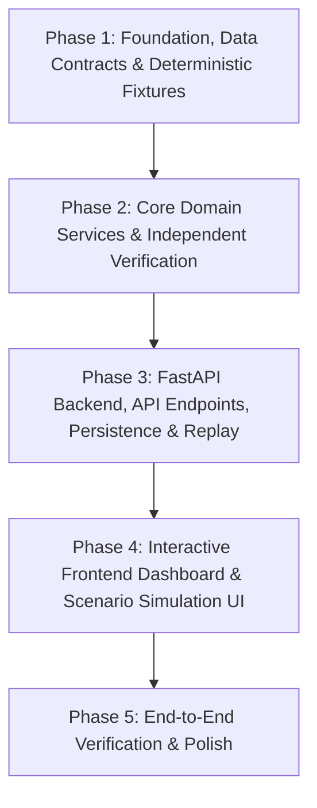

# RoadMind AI — Milestone 1 (MVP) Implementation Roadmap

## Overview & Phase Structure
Milestone 1 focuses on delivering a fully functional, demonstrable smart traffic & road condition intelligence platform for NEXATHON 2026 (Traffic Intelligence Track). Each phase is an atomic, verifiable unit of work with explicit acceptance criteria.

---

## Phase Status Summary
| Phase | Title | Status | Tests | Delivered Capabilities |
| :--- | :--- | :---: | :---: | :--- |
| **Phase 1** | Foundation, Data Contracts & Deterministic Fixtures | ✅ Completed | 27/27 | SQLAlchemy models, Pydantic v2 schemas, SQLite database, GeoJSON network, seed pipeline (`pipelines/ingest/seed.py`), 12 benchmark fixtures with SHA-256 manifest. |
| **Phase 2** | Core Domain Services & Independent Verification | ✅ Completed | 30/30 | Evidence assessment engine, NetworkX scenario router, assumption-sensitive recommendation engine, forecasting engine (persistence & median), road memory & inspection priority. |
| **Phase 4** | Interactive Frontend Dashboard & Scenario Simulation UI | ✅ Completed | 8/8 | React 19/TS/Vite web app, Leaflet vector map, From/Dest route planner, 3-way scenario simulations, citizen intake, operator review, Recharts forecasting & memory priorities. |
| **Phase 5** | End-to-End Verification & Documentation Polish | ⏳ Next Up | — | End-to-end integration verification, presentation demo script, submission packaging. |

---

## Phase 1: Foundation, Data Contracts & Deterministic Fixtures
- **Objective**: Establish the relational database schema, strict Pydantic v2 validation contracts, deterministic benchmark network, and idempotent seeding.
- **Verification Gate**:
  - All 12 benchmark fixtures validated against SHA-256 checksums in `manifest.json`.
  - 27 unit tests passing covering schema bounds, negative values, and unique constraints.

---

## Phase 2: Core Domain Services & Independent Verification
- **Objective**: Implement pure, isolated domain services for evidence assessment, scenario routing, forecasting, and road memory.
- **Verification Gate**:
  - Baseline graph immutability verified under scenario overrides.
  - Replay temporal filter prevents future observation leakage.
  - 30 unit tests passing (total 57 unit tests).

---

## Phase 3: FastAPI Backend, API Endpoints, Persistence & Replay
- **Objective**: Expose all Phase 2 domain services via clean, auditable REST endpoints under `/api/v1` and health check at `/api/health`.
- **Key Deliverables**:
  1. FastAPI app factory with non-destructive startup lifecycle.
  2. Endpoints:
     - `GET /api/health`
     - `GET /api/v1/network`
     - `GET /api/v1/road-state?at=...`
     - `POST /api/v1/reports`
     - `GET /api/v1/incidents`
     - `GET /api/v1/incidents/{id}`
     - `POST /api/v1/reports/{id}/evidence`
     - `POST /api/v1/incidents/{id}/reviews`
     - `GET /api/v1/forecasts`
     - `GET /api/v1/evaluations`
     - `POST /api/v1/simulations`
     - `GET /api/v1/simulations/{id}`
     - `POST /api/v1/simulations/compare`
     - `GET /api/v1/segments/{id}/history`
     - `GET /api/v1/memory/priority`
  3. Server-side SHA-256 evidence hashing and duplicate detection.
  4. Idempotency protection on report submission (HTTP 409 on conflict).
  5. Reviewer authorization boundary (`X-Reviewer-Role` / `X-Reviewer-Token`, HTTP 403 on unauthenticated).
  6. Temporal replay filtering across observations, reports, reviews, and forecasts.
- **Verification Gate**:
  - 16/16 integration tests passing (total 73 tests passing).
  - Database persistence verified across simulated application restarts.

---

## Phase 4: Interactive Frontend Dashboard & Scenario Simulation UI
- **Objective**: Build a modern, reactive web UI for traffic operators and citizens connecting to the `/api/v1` backend.
- **Verification Gate**:
  - `bun run tsc -b` passes with 0 errors.
  - `bun test` passes 8/8 tests.
  - Production bundle generated cleanly (`dist/` built in 1.18s).
  - All 9 application workspaces fully interactive and connected to real endpoints.

---

## Phase 5: End-to-End Verification, Live Demo Script & Polish
- **Objective**: Run complete end-to-end user journeys, benchmark response times, and polish presentation materials for NEXATHON 2026.
- **Key Tasks**:
  1. Full-stack verification with live FastAPI backend on `:8000` and Vite dev server on `:5173`.
  2. Document 3-minute hackathon judge walkthrough script.
  3. Final submission packaging.
