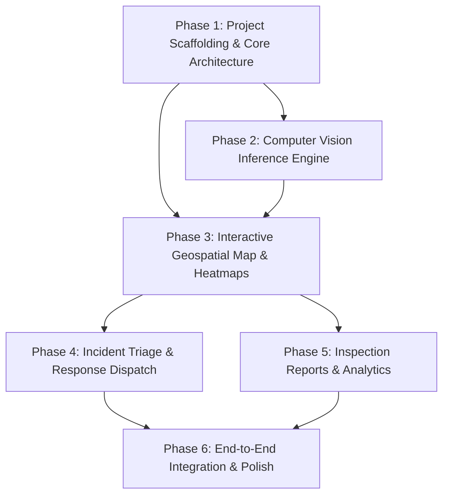

# RoadMind AI — Milestone 1 (MVP) Implementation Roadmap

## Overview & Phase Structure
Milestone 1 focuses on delivering a fully functional, demonstrable smart traffic & road condition intelligence platform. Each phase is an atomic, verifiable unit of work with explicit acceptance criteria.

---

## Phase 1: Project Scaffolding & Core Architecture
- **Objective**: Establish the full-stack architecture, database models, seed data, API schemas, and modern UI foundation.
- **Requirements Covered**: `REQ-API-01`, `REQ-API-03`, `REQ-API-04`, `REQ-UI-01`, `REQ-NFR-04`
- **Key Tasks**:
  1. Initialize FastAPI backend structure with CORS, Uvicorn runner, and environment settings.
  2. Implement SQLite database schema using SQLAlchemy / SQLModel: `Defect`, `Incident`, `MediaRecord`, `DispatchLog`.
  3. Create seed script generating realistic municipal road defects (potholes, cracks, hazards) with geo-coordinates.
  4. Scaffold React + Vite + TypeScript frontend with custom modern dark command center design tokens and layout.
  5. Setup unified startup scripts and API client integration.
- **Verification Gate**:
  - Backend runs on `http://127.0.0.1:8000` with Swagger docs at `/docs`.
  - Frontend renders command center shell with live backend connectivity check.
  - Automated tests pass for DB models and health check.

---

## Phase 2: Computer Vision Inference Engine & Media Processing
- **Objective**: Implement the computer vision detection pipeline for road distress, pothole depth/severity estimation, and media annotation.
- **Requirements Covered**: `REQ-CV-01`, `REQ-CV-02`, `REQ-CV-03`, `REQ-CV-04`, `REQ-CV-05`, `REQ-API-02`, `REQ-NFR-02`
- **Key Tasks**:
  1. Build CV inference service utilizing YOLOv8 / ONNX / OpenCV for asphalt defect detection (potholes, cracks, surface wear).
  2. Implement severity calculation engine (`Low`, `Medium`, `High`, `Critical`) based on bounding box geometry and surface context.
  3. Implement EXIF GPS extraction with fallback geo-locator for uploaded photos.
  4. Create image annotation pipeline that draws stylized bounding boxes, confidence tags, and defect badges onto images.
  5. Build `/api/detect` upload endpoint with asynchronous processing and instant database record creation.
  6. Build frontend media upload dropzone with preview, progress state, and live detection results display.
- **Verification Gate**:
  - Uploading test road images produces annotated output images with correct bounding boxes and severity classifications.
  - Extracted GPS coordinates and defects persist to the database.
  - End-to-end upload test executes under 1.5 seconds.

---

## Phase 3: Interactive Geospatial Map Dashboard & Heatmap Layer
- **Objective**: Build the centralized command center map with real-time hazard markers, density heatmaps, and inspector flyouts.
- **Requirements Covered**: `REQ-MAP-01`, `REQ-MAP-02`, `REQ-MAP-03`, `REQ-MAP-04`, `REQ-MAP-05`, `REQ-MAP-06`, `REQ-NFR-01`
- **Key Tasks**:
  1. Integrate Leaflet / React-Leaflet with dark-mode tile providers and fluid zoom/pan controls.
  2. Render severity-coded custom markers (Critical Red, High Orange, Medium Amber, Low Emerald) with SVG pulse animations for critical hazards.
  3. Integrate `leaflet.heat` to provide a toggleable distress density heatmap layer.
  4. Implement marker clustering (`react-leaflet-cluster`) for optimal rendering performance with high marker density.
  5. Build Defect Inspector sidebar/modal: displays high-res annotated photo, defect class, severity rating, GPS coordinates, road address, and incident status.
  6. Add dynamic filter toolbar (filter by severity, defect type, incident status, date range).
- **Verification Gate**:
  - Map renders smoothly with responsive pan/zoom.
  - Heatmap toggle accurately displays density gradients.
  - Clicking any marker opens inspector view with photo evidence and correct metadata.

---

## Phase 4: Incident Triage & Emergency Response Dispatch
- **Objective**: Implement the full incident management lifecycle, dispatch workflows, crew assignments, and audit logging.
- **Requirements Covered**: `REQ-DISP-01`, `REQ-DISP-02`, `REQ-DISP-03`, `REQ-DISP-04`
- **Key Tasks**:
  1. Automatic incident creation triggers for high and critical severity defects.
  2. Build Incident Management Command Panel with tabbed views: Active Incidents, In-Progress, Dispatched, Resolved.
  3. Implement dispatch modal: assign municipal repair team / contractor, set priority escalation, and assign target resolution ETA.
  4. Build status transition engine (`Reported` -> `Triaged` -> `Dispatched` -> `In-Progress` -> `Resolved`) with audit logging.
  5. Live dispatch notification toast and activity ticker for dispatchers.
- **Verification Gate**:
  - Changing incident status updates the database and reflects immediately across map markers and incident lists.
  - Full audit trail is recorded for each dispatch action.

---

## Phase 5: Inspection Reports, Analytics & Data Export
- **Objective**: Provide municipal-grade inspection reporting (PDF & CSV), Pavement Condition Index (PCI) analytics, and KPI dashboards.
- **Requirements Covered**: `REQ-REP-01`, `REQ-REP-02`, `REQ-REP-03`, `REQ-REP-04`
- **Key Tasks**:
  1. Build executive KPI overview cards: Total Defects, Critical Potholes, Active Incidents, Average PCI Score, Resolution Rate.
  2. Implement interactive analytics charts (defect distribution breakdown, severity trends, dispatch resolution timeline).
  3. Create PDF Inspection Report generator containing municipal header, date range summary, severity breakdown, detailed defect table, and photo evidence.
  4. Implement CSV and GeoJSON export endpoints for external GIS system integration.
  5. Build Report Export UI modal allowing users to customize date range, jurisdiction, and export format.
- **Verification Gate**:
  - Generated PDF report is structurally complete, styled, and contains valid defect tables and photos.
  - CSV / GeoJSON export outputs valid schema accepted by standard GIS tools.
  - Analytics cards update dynamically with live database stats.

---

## Phase 6: End-to-End System Integration, Verification & Polish
- **Objective**: Conduct comprehensive end-to-end user flow testing, UI polish, performance verification, and documentation.
- **Requirements Covered**: All requirements, `REQ-NFR-01`, `REQ-NFR-02`, `REQ-NFR-03`, `REQ-NFR-04`
- **Key Tasks**:
  1. Execute comprehensive end-to-end testing across all core user journeys (Upload -> Detect -> Map View -> Dispatch -> Resolve -> Export Report).
  2. Optimize frontend rendering, transitions, and loading states.
  3. Verify error handling for invalid files, network timeouts, and extreme coordinates.
  4. Create comprehensive README with architecture overview, installation instructions, and demo guide.
- **Verification Gate**:
  - Full end-to-end demo flow runs without console errors or backend exceptions.
  - All automated tests pass with green status.
  - Performance targets met (< 300ms queries, < 1.5s inference).
